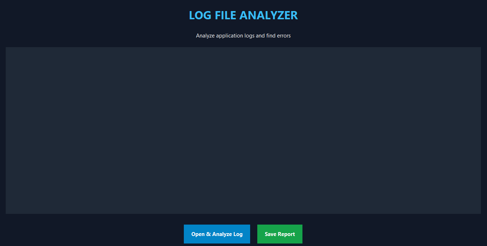
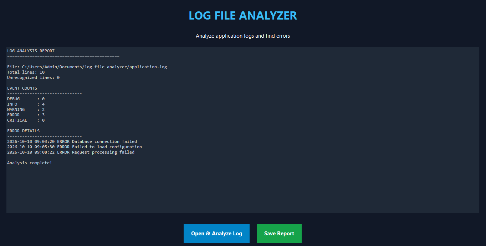

# 🖥️ Log File Analyzer

A beginner-friendly Python project that analyzes application log files, counts event types, and identifies errors. It includes a desktop graphical interface and a terminal-based version.

## ✨ Features

- 🪟 Desktop GUI built with Tkinter
- 📂 Open and analyze `.log` and `.txt` files
- 📊 Count DEBUG, INFO, WARNING, ERROR, and CRITICAL events
- 🚨 Display error and critical event details
- 💾 Save analysis reports as text files
- 💻 Run the analyzer directly from the terminal

## 🖼️ Screenshots

### Application Interface



### Log Analysis Results



## 🛠️ Technologies Used

- **Python 3** — core programming language
- **Tkinter** — desktop graphical interface
- **Regular Expressions (`re`)** — identify log event types
- **Counter** — count event categories
- **Git and GitHub** — version control and project hosting

## 📁 Project Structure

```text
log-file-analyzer/
├── app.py
├── main.py
├── application.log
├── README.md
├── .gitignore
└── screenshots/
    ├── GUI.png
    └── Analysis.png
```

### File Description

| File | Purpose |
|---|---|
| `app.py` | Desktop GUI version |
| `main.py` | Terminal-based version |
| `application.log` | Sample input log file |
| `README.md` | Project documentation |
| `.gitignore` | Excludes temporary files |
| `screenshots/` | Application screenshots |

## ⚙️ Requirements

- Python 3 installed on your computer
- Tkinter available in your Python installation

No third-party Python packages are required.

## 🚀 Getting Started

### 1. Clone the repository

```bash
git clone https://github.com/vrushabhakamdi-dev/log-file-analyzer.git
cd log-file-analyzer
```

### 2. Run the desktop application

```bash
python app.py
```

Click **Open & Analyze Log**, select a `.log` or `.txt` file, and view the results. Click **Save Report** to save the analysis.

### 3. Run the terminal version

```bash
python main.py
```

Make sure `application.log` is present in the project directory if the terminal script expects that filename.

## 📋 Example Log Entries

```text
2026-10-10 09:03:20 INFO Application started
2026-10-10 09:03:25 WARNING High memory usage
2026-10-10 09:03:30 ERROR Database connection failed
```

The analyzer identifies the event types, counts them, and displays error details.

## 🎯 What I Learned

- Reading and processing files with Python
- Using regular expressions
- Counting and categorizing log events
- Building desktop applications with Tkinter
- Generating text reports
- Managing code with Git and GitHub

## 🔮 Future Improvements

- Filter logs by severity and date
- Add charts and visual analytics
- Search for specific log messages
- Export reports to CSV
- Add advanced log filtering

## 👨‍💻 Author

**Vrushabh Kamdi**

GitHub: [@vrushabhakamdi-dev](https://github.com/vrushabhakamdi-dev)

## 📄 License

No license has been specified yet.